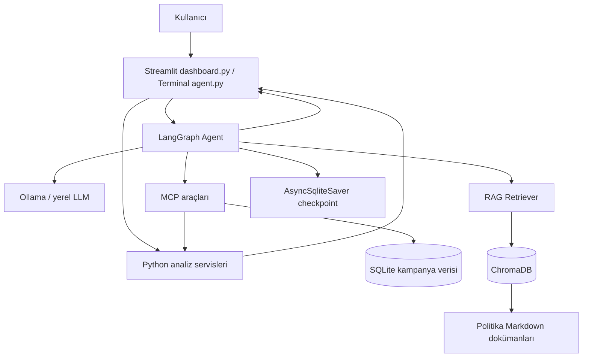
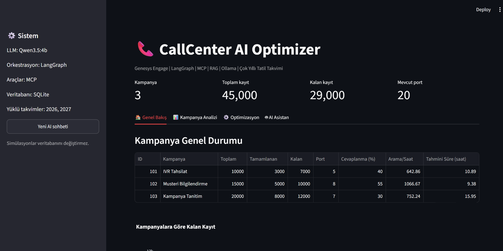
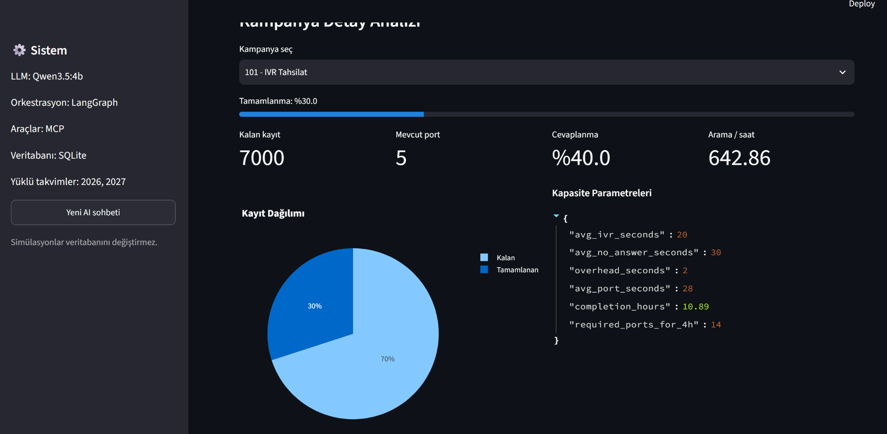
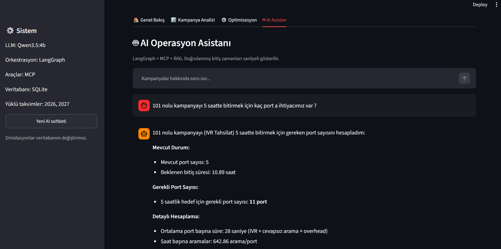
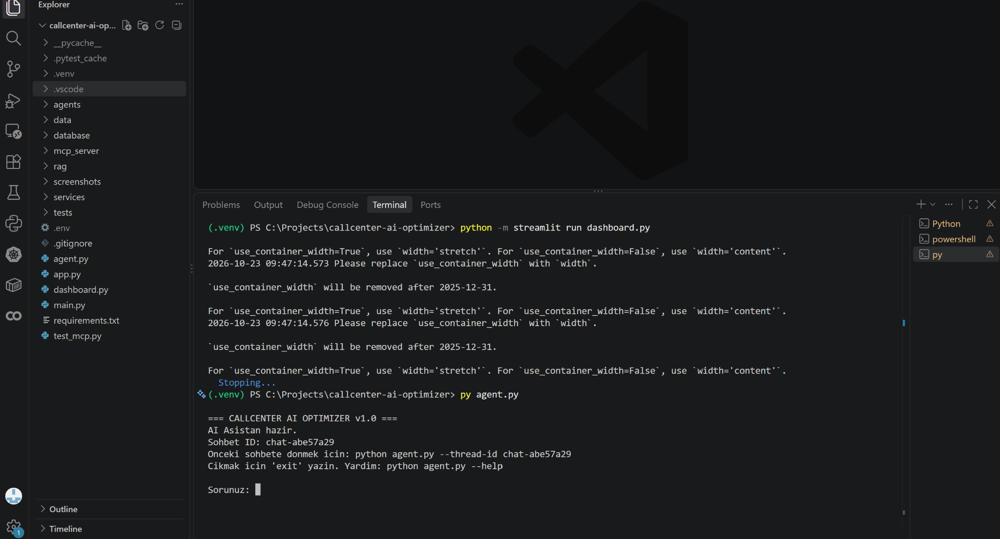
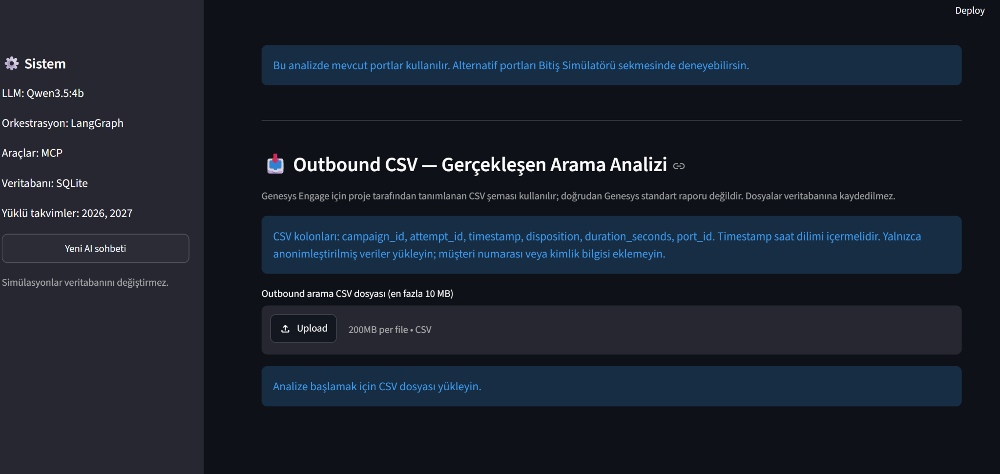
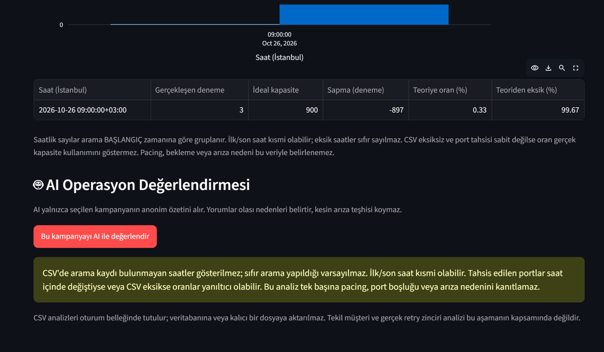

# CallCenter AI Optimizer v1.0

**Genesys Engage outbound kampanyaları için Agentic AI destekli kapasite, retry ve operasyon analizi — CSV tabanlı MVP**

> **Proje durumu:** v1.0 MVP. Kullanıcının Windows ortamında release smoke test, tüm pytest testleri, dört dashboard ekranı ve AI Agent çalışması başarılı doğrulanmıştır. Bu sürüm canlı Genesys Engage sunucusuna bağlanmaz; kampanya ayarlarını otomatik değiştirmez.

## İçindekiler

1. [Projenin amacı ve çözülen problem](#1-projenin-amacı-ve-çözülen-problem)
2. [Kurulum ve çalıştırma](#2-kurulum-ve-çalıştırma)
3. [Kullanılan temel teknolojiler](#3-kullanılan-temel-teknolojiler)
4. [Klasör yapısı ve dosyaların görevleri](#4-klasör-yapısı-ve-dosyaların-görevleri)
5. [Sistem mimarisi ve çalışma akışı](#5-sistem-mimarisi-ve-çalışma-akışı)
6. [Temel özellikler ve hesaplama örnekleri](#6-temel-özellikler-ve-hesaplama-örnekleri)
   - [Uygulama ekran görüntüleri](#65-uygulama-ekran-görüntüleri)
7. [MCP, RAG ve birlikte kullanım testleri](#7-mcp-rag-ve-birlikte-kullanım-testleri)
8. [Hafıza ve oturum testleri](#8-hafıza-ve-oturum-testleri)
9. [Normal ve debug modu](#9-normal-ve-debug-modu)
10. [Karşılaşılan sorunlar ve çözümler](#10-karşılaşılan-sorunlar-ve-çözümler)
11. [Testler ve kabul kriterleri](#11-testler-ve-kabul-kriterleri)
12. [Değerlendirme kriterleriyle eşleştirme](#12-değerlendirme-kriterleriyle-eşleştirme)
13. [Değerlendirici demo senaryosu](#13-değerlendirici-demo-senaryosu)
14. [Sınırlamalar, güvenlik ve sonraki sürüm](#14-sınırlamalar-güvenlik-ve-sonraki-sürüm)

---

## 1. Projenin amacı ve çözülen problem

Çağrı merkezlerindeki **Genesys Engage outbound kampanyalarında** bir kampanyanın ne zaman biteceğini tahmin etmek, port kapasitesini planlamak, cevapsız aramaların tekrar deneme (retry) yükünü hesaplamak ve gerçekleşen performansın neden teorik kapasiteden farklılaştığını incelemek zordur.

Örneğin, **7.000 arama denemesi**, **5 eşzamanlı port** ve **20 saniye ortalama port işgali** için:

- Teorik hız: `5 × 3600 / 20 = 900 deneme/saat`
- Aktif çalışma: `7000 / 900 ≈ 7,78 saat`
- Bu değer **7 saat 47 dakika boyunca 5 portun birlikte çalışması** demektir; toplam port işgali yaklaşık **38,89 port-saat**tir.

Bu tahmin, çalışma saatleri, resmi tatiller, dialer pacing, boş portlar ve retry beklemeleri nedeniyle gerçek takvim bitişinden farklı olabilir. Proje, bu varsayımları görünür kılarak operasyon ekibine **karar destek** sunmayı amaçlar.

**Hedef kullanıcılar:** Outbound operasyon sorumluları, kapasite planlama ekipleri, kampanya yöneticileri ve Genesys Engage teknik ekipleri.

**Neden AI?** Deterministik Python servisleri sayısal hesapları üretir; AI Agent kampanya verisini MCP araçlarından, politika bilgisini RAG dokümanlarından alarak bulguları açıklamaya ve uygulanabilir kontrol önerileri sunmaya yardımcı olur. AI'ın hesap uydurması yerine doğrulanabilir araç sonuçlarının kullanılması hedeflenir.

## 2. Kurulum ve çalıştırma

### 2.1 Ön koşullar

- Windows ve PowerShell; VS Code isteğe bağlıdır.
- Çalışan bir Python sanal ortamı (`venv`). Geliştirme sırasında Python 3.14 kullanılmıştır; başka sürümlerde bağımlılık uyumluluğu ayrıca kontrol edilmelidir.
- Projenin **tam kaynak klasörü**, `requirements.txt`, `.env` yapılandırması ve gerekli veri/doküman dosyaları.
- AI özellikleri için kurulu ve çalışan **Ollama** ile projede yapılandırılan model (geliştirme örneği: `qwen3.5:4b`). Model adı `agents/graph.py` ve ortam ayarlarıyla tutarlı olmalıdır.
- Bu README veya önceki final ZIP **tek başına eksiksiz proje dağıtımı değildir**; final ZIP mevcut çalışan projenin üzerine uygulanacak dosyaları içerir.

### 2.2 Ortamı hazırlama

```powershell
cd C:\Projects\callcenter-ai-optimizer

# Sanal ortam zaten varsa yeniden oluşturmayın.
python -m venv venv
.\venv\Scripts\Activate.ps1

python -m pip install -r requirements.txt
```

> `requirements.txt` sürümlerini çalışan proje ortamınızdan kullanın. Özellikle LangGraph, LangChain, MCP ve SQLite checkpointer sürümleri arasında uyumluluk önemlidir. `venv` zaten çalışıyorsa oluşturma komutunu atlayın.

Ollama modeli kurulu değilse:

```powershell
ollama list
ollama pull qwen3.5:4b
```

`ollama pull` için internet bağlantısı gerekir. Farklı model kullanılıyorsa proje yapılandırmasındaki model adını da eşleştirin. Ollama'nın arka planda çalıştığından emin olun.

### 2.3 Veri ve doküman hazırlığı

- `data/campaigns.db` mevcut değilse `database/init_db.py` içindeki başlatma akışını kullanın; bu işlem örnek verileri oluşturabilir veya değiştirebilir. Mevcut veritabanınızı önce yedekleyin.
- RAG için `data/documents/` altındaki politika dokümanları ve `rag/ingest.py` ile oluşturulan vektör indeksinin hazır olması gerekir. Yeni ortamda indeks yoksa `rag/ingest.py` dosyasının beklediği argümanları inceleyerek indeksleme yapın; burada doğrulanmamış bir komut dayatılmıyor.
- 2026 ve 2027 takvim dosyaları `data/holidays_tr_2026.json` ve `data/holidays_tr_2027.json` altında bulunmalıdır.

### 2.4 Uygulamayı başlatma

```powershell
# Web arayüzü
python -m streamlit run dashboard.py

# Terminalde sade AI asistan
python agent.py

# MCP/RAG/Graph araç izleriyle inceleme
python agent.py --debug

# Yardım
python agent.py --help
```

Önceki konuşmanın hafızasını devam ettirmek için terminalin gösterdiği sohbet kimliğini kullanın:

```powershell
python agent.py --thread-id chat-xxxxxxxx
```

`chat-xxxxxxxx` örnek değerdir; **kendi terminalinizde gösterilen gerçek kimliği** yazın.

### 2.5 Testleri çalıştırma

```powershell
python -m pytest tests/test_release_smoke.py -v
python -m pytest -v
```

Son doğrulamada kullanıcı ortamında smoke test, tüm pytest testleri, dashboard ve AI Agent **PASS** bildirilmiştir. Bu sonuç canlı Genesys bağlantısı veya üretim yük testi yapıldığı anlamına gelmez.

## 3. Kullanılan temel teknolojiler

| Teknoloji | Projedeki görevi | Tercih nedeni |
|---|---|---|
| **Python** | İş kuralları, kapasite, retry ve veri analizleri | Okunabilir, test edilebilir servis yapısı |
| **Streamlit** | Dört ana bölümlü web dashboard | Hızlı etkileşimli prototipleme |
| **Plotly / Pandas** | Grafikler ve CSV analizi | Operasyon metriklerini görselleştirme |
| **LangGraph** | AI Agent yürütme akışı ve araç kullanımı | Çok adımlı durum/akış yönetimi |
| **LangChain entegrasyonları** | Model ve araç bağlama | Ollama ve MCP ekosistemiyle birlikte çalışma |
| **Ollama** | Yerel LLM çalıştırma | Veriyi yerel ortamda işleyebilme |
| **Qwen (örnek: `qwen3.5:4b`)** | Türkçe soru-cevap ve yorum üretimi | Yerel model seçeneği; kesin model adı ayarlara bağlı |
| **MCP (Model Context Protocol)** | Kampanya ve hesaplama araçlarına standart arayüz | Agent'ın kontrollü araç çağırması |
| **RAG + ChromaDB** | Politika dokümanlarından ilgili içerik getirme | Modeli yeniden eğitmeden bilgiye dayalı yanıt |
| **SQLite** | Kampanya verisi ve Agent checkpoint hafızası | Yerel, hafif kalıcılık |
| **AsyncSqliteSaver** | LangGraph sohbet checkpoint'leri | `thread_id` bazında bağlamı sürdürme |
| **Pytest** | Servis, entegrasyon ve release smoke testleri | Tekrarlanabilir doğrulama |
| **zoneinfo / Europe/Istanbul** | Mesai ve tatil takvimi hesapları | Saat dilimine duyarlı tarih hesaplama |

**Eğitim yaklaşımı:** Bu MVP'de model fine-tuning veya sıfırdan LLM eğitimi yapılmamıştır. RAG, prompt tasarımı, tool calling ve checkpoint hafızası kullanılmıştır. RAG bir model eğitimi yöntemi değildir.

## 4. Klasör yapısı ve dosyaların görevleri

Aşağıdaki ağaç, geliştirme boyunca kullanılan dosya adları ve final sürümdeki bilinen bileşenler üzerinden hazırlanmıştır. **Tam Git deposunun tüm dosyaları bu oturumda paylaşılmadığı için** ağaç, projenin doğrulanmış/konuşmada adı geçen temel dosyalarını gösterir; yerel depoda ek dosyalar bulunabilir.

```text
callcenter-ai-optimizer/
│
├── agent.py                         # Terminal AI asistanı; normal/debug modu
├── dashboard.py                     # Streamlit web arayüzü (4 ana bölüm)
├── main.py                          # Projenin önceki komut satırı/giriş akışı
├── test_mcp.py                      # MCP bağlantısı/araç denemeleri
├── requirements.txt                 # Python paket bağımlılıkları
├── .env                             # Yerel yapılandırma ve gizli ayarlar
├── .gitignore                       # Git'e eklenmemesi gereken dosyalar
├── README.md                        # Bu kullanım ve değerlendirme rehberi
│
├── agents/
│   ├── graph.py                     # LangGraph Agent kurulumu ve araç bağlama
│   └── prompts.py                   # Agent sistem yönergeleri / promptlar
│
├── database/
│   └── init_db.py                   # SQLite kampanya şeması ve örnek veri
│
├── mcp_server/
│   └── server.py                    # Kampanya/hesaplama MCP araç sunucusu
│
├── rag/
│   ├── ingest.py                   # Dokümanları vektör veritabanına alma
│   └── retriever.py                # İlgili politika pasajlarını getirme
│
├── services/
│   ├── capacity_engine.py          # Temel arama kapasitesi hesabı
│   ├── port_optimizer.py           # Port dağıtım senaryoları
│   ├── schedule_planner.py         # Mesai, tatil, tahmini bitiş tarihi
│   ├── retry_simulator.py          # İlk retry simülasyonu
│   ├── retry_capacity.py           # Beklenen retry yükü ve port-saat
│   ├── retry_policy.py             # Tur bazlı retry bekleme politikası
│   ├── retry_dispositions.py       # Answered/No Answer/Busy/Failed dağılımı
│   ├── outbound_importer.py        # CSV okuma ve doğrulama
│   ├── observed_capacity.py        # CSV gözleminden kapasite tahmini
│   ├── performance_variance.py     # Saatlik teorik/gerçekleşen sapma
│   └── operations_brief.py         # AI için toplulaştırılmış operasyon özeti
│
├── data/
│   ├── campaigns.db                # Yerel kampanya SQLite verisi
│   ├── agent_memory.db             # Sohbet checkpoint veritabanı
│   ├── outbound_attempts_example.csv # Sentetik arama denemesi örneği
│   ├── holidays_tr_2026.json       # 2026 çalışma/tatil takvimi
│   ├── holidays_tr_2027.json       # 2027 çalışma/tatil takvimi
│   ├── documents/
│   │   ├── outbound_campaign_policy.md # Kampanya politika bilgileri
│   │   └── retry_rules.md          # Retry kuralları
│   └── chroma_db/                  # Üretilmiş RAG vektör indeksi
│
└── tests/
    ├── test_capacity.py            # Kapasite hesabı testleri
    ├── test_optimization.py        # Port optimizasyonu testleri
    ├── test_schedule_multiyear.py  # Çok yıllı takvim testleri
    ├── test_retry_capacity.py      # Retry yükü testleri
    ├── test_retry_policy.py        # Tur ve bekleme süresi testleri
    ├── test_retry_dispositions.py  # Sonuç kodu retry testleri
    ├── test_outbound_importer.py   # CSV doğrulama testleri
    ├── test_observed_capacity.py   # Gözlenen kapasite testleri
    ├── test_performance_variance.py # Saatlik sapma testleri
    ├── test_operations_brief.py    # AI operasyon özeti testleri
    └── test_release_smoke.py       # Sürüm öncesi temel kontrol
```

### 4.1 Kök dizin

- **`agent.py`:** Kullanıcıdan terminalde soru alır, LangGraph Agent'ı çağırır, yanıtı yazdırır. `--debug` ile node/araç izlerini gösterir; `--thread-id` ile mevcut checkpoint sohbetini yeniden kullanabilir. MCP'den dönen bitiş tarihini ayrıca doğrulayarak gösterebilir.
- **`dashboard.py`:** Kullanıcıların kod yazmadan kampanya, CSV, retry, port ve AI analizlerini çalıştırdığı Streamlit uygulaması. Dört ana bölüm: **Genel Bakış, Kampanya Analizi, Optimizasyon, AI Asistan**.
- **`main.py`:** Geliştirme sürecinde kullanılan giriş dosyası; final kullanım için önerilen giriş noktaları `agent.py` ve `dashboard.py` dosyalarıdır. İçeriği bu oturumda doğrulanmadığından kesin görev ayrıntısı iddia edilmez.
- **`test_mcp.py`:** MCP denemeleri için yardımcı dosya; çalıştırma davranışı yerel içeriğine bağlıdır.
- **`requirements.txt`:** Paket bağımlılıklarının ve varsa sürüm sabitlemelerinin kaynağı.
- **`.env`:** Ortam ayarları; parolalar/token'lar burada bulunuyorsa Git'e gönderilmemelidir.
- **`.gitignore`:** `venv`, `.env`, geçici çıktı ve hassas yerel verileri sürüm kontrolünden hariç tutmak için kullanılır.

### 4.2 `agents/` — Agent orkestrasyonu

- **`graph.py`:** `create_callcenter_agent` ile Agent oluşturulması, model ve araçların bir araya getirilmesi. `MEMORY_DB` yolunun tanımlandığı modüldür.
- **`prompts.py`:** Agent'ın rolü, araç kullanımı ve yanıt yaklaşımını belirleyen yönergelerin tutulduğu modül.

### 4.3 `database/` — Yapılandırılmış kampanya verisi

- **`init_db.py`:** `campaigns` tablosu ve örnek kampanya verilerini hazırlar. Bilinen alanlar: `id`, `name`, `total_records`, `completed_records`, `ports`, `answer_rate`, `avg_ivr_seconds`, `avg_no_answer_seconds`, `overhead_seconds`.

### 4.4 `mcp_server/` — MCP araç katmanı

- **`server.py`:** Agent'ın kampanya verisini ve hesaplama sonuçlarını araçlar üzerinden istemesini sağlar. Araç isimleri ve argümanları sunucunun mevcut koduna bağlıdır; `agent.py --debug` çıktısı gerçek çağrıları gösterir.

### 4.5 `rag/` — Doküman erişimi

- **`ingest.py`:** Markdown politika belgelerini indeksleme hattına alır.
- **`retriever.py`:** Kullanıcı sorusuna ilgili doküman pasajlarını getirir. Yanıtın gerçekten RAG ile desteklendiğini göstermek için debug'da ilgili araç/erişim izini incelemek gerekir.

### 4.6 `services/` — Deterministik iş kuralları

- **`capacity_engine.py`:** Ortalama deneme süresinden teorik arama kapasitesini ve gereken port sayısını hesaplar.
- **`port_optimizer.py`:** Belirli toplam port bütçesiyle kampanyalara port dağılımı senaryosu üretir.
- **`schedule_planner.py`:** İstanbul saat dilimi, 09:00–18:00 mesai, hafta sonları ve tam/yarım gün tatillerini dikkate alır.
- **`retry_simulator.py`:** İlk aşamalarda geliştirilen retry simülasyonu.
- **`retry_capacity.py`:** Cevapsızların yeniden aranması varsayımıyla beklenen ek deneme sayısı ve aktif süreyi hesaplar.
- **`retry_policy.py`:** Her retry turunun bitişi ve bir sonraki turun bekleme aralığını takvime yansıtır.
- **`retry_dispositions.py`:** `ANSWERED`, `NO_ANSWER`, `BUSY`, `FAILED` sonuçlarına ayrı retry oranları uygular. Bunlar örnek mantıksal sınıflardır; gerçek Genesys kodlarıyla eşleştirme gerekir.
- **`outbound_importer.py`:** CSV sözleşmesini kontrol eder ve çağrı denemelerinden özetler çıkarır.
- **`observed_capacity.py`:** CSV'de gözlenen port işgal sürelerini kullanarak teorik aktif süreyi yeniden hesaplar.
- **`performance_variance.py`:** Saatlik gerçekleşen denemeleri teorik kapasiteyle karşılaştırır.
- **`operations_brief.py`:** Ham çağrı satırlarını göndermek yerine AI değerlendirmesine toplulaştırılmış kampanya metrikleri hazırlar.

### 4.7 `data/` — Girdi ve kalıcı veriler

- **`campaigns.db`:** Kampanya kayıtları; uygulama tarafından okunur.
- **`agent_memory.db`:** LangGraph `AsyncSqliteSaver` checkpoint'leri; dosya konumu `MEMORY_DB` tanımına göre değişebilir.
- **`outbound_attempts_example.csv`:** Kişisel veri içermeyen örnek CSV.
- **`holidays_tr_2026.json`, `holidays_tr_2027.json`:** Bitiş tarihi hesaplarında kullanılan tatil/yarım gün tanımları.
- **`documents/*.md`:** RAG'in dayandığı politika metinleri.
- **`chroma_db/`:** Yeniden üretilebilen yerel vektör indeksi; kaynak dokümanların yerine geçmez.

### 4.8 `tests/` — Doğrulama

Her `test_*.py` dosyası karşılık gelen servis davranışını, sınır koşullarını ve hatalı girdileri sınamak için kullanılır. `test_release_smoke.py` sürümün temel modüllerini ve örnek veri akışını hızlıca kontrol eder. Test dosyalarını `data/` içine kopyalamayın; aynı isimli test dosyaları pytest modül çakışmasına yol açabilir.

## 5. Sistem mimarisi ve çalışma akışı



**Ayrım:** Kampanya kayıtları ve hesaplama sonuçları MCP/servis katmanından; kurallar ve açıklayıcı politika pasajları RAG katmanından gelir. LLM bunları yorumlar. Hafıza `thread_id` üzerinden konuşma bağlamını sürdürür; ayrı bir model eğitimi yapılmaz.

## 6. Temel özellikler ve hesaplama örnekleri

### 6.1 Dashboard bölümleri

1. **Genel Bakış:** Kampanya ve kalan kayıt özetleri.
2. **Kampanya Analizi:** CSV yükleme, sonuç kodları, gözlenen kapasite, saatlik sapma ve AI operasyon değerlendirmesi.
3. **Optimizasyon:** Port dağılımı, mesai/tatil takvimine göre bitiş tahmini, retry turları ve sonuç kodu politikaları.
4. **AI Asistan:** Doğal dille kampanya soruları; MCP, RAG ve hafıza akışları.

### 6.2 Teorik kapasite hesabı

```text
Saatlik kapasite = Port sayısı × 3600 / Ortalama port işgal süresi
Aktif saat = Kalan arama denemesi / Saatlik kapasite
```

**Örnek:** 5 port, 20 saniye, 7.000 deneme → 900 deneme/saat → **7,78 aktif saat**.

> Başka bir hesaplama örneğinde cevaplanma olasılığı %40, cevaplanan çağrı 20 sn, cevaplanmayan çağrı 30 sn ve overhead 2 sn ise beklenen süre `0,4×20 + 0,6×30 + 2 = 28 sn` olur. 7.000 deneme / 5 port için yaklaşık **10,89 saat** çıkar. **7,78 ile 10,89 saat çelişki değildir**; farklı süre varsayımlarına dayanırlar.

### 6.3 Retry ve sonuç kodları

- Retry hesapları **beklenen değer** üretir; 11.904,375 gibi ondalıklı sonuçlar tek tek fiziksel çağrılar değil istatistiksel ortalamadır.
- Retry bekleme politikasında turlar arası duvar saati beklemesi, mesai ve tatil takviminden ayrı değerlendirilir.
- `BUSY` için %50, `NO_ANSWER` için %100 gibi oranlar kullanıcı tarafından senaryoya göre değiştirilebilir.

### 6.4 CSV sözleşmesi

```csv
campaign_id,attempt_id,timestamp,disposition,duration_seconds,port_id
```

- `timestamp` saat dilimi ofseti içerir (örn. `+03:00`).
- Örnek `disposition` değerleri: `ANSWERED`, `NO_ANSWER`, `BUSY`, `FAILED`.
- Bu kolonlar **projenin kabul ettiği format** olup Genesys Engage'in tüm kurulumları için standart export iddiası değildir.
- Önceki final rehberindeki sınırlar: en fazla **10 MB** ve **100.000 satır**.
- `duration_seconds` port işgalini temsil etmiyorsa teorik kapasite yorumu geçersizleşebilir.
- Saatlik deneme sayısı / teorik kapasite oranı **ölçülmüş port doluluğu değildir**.

### 6.5 Uygulama ekran görüntüleri

Aşağıdaki ekran görüntüleri çalışan **CallCenter AI Optimizer v1.0** uygulamasından alınmıştır. Görseller `screenshots/` klasöründe tutulur ve README içindeki **göreli yollar** sayesinde GitHub üzerinde doğrudan görüntülenir.

#### 6.5.1 Dashboard — Genel Bakış



*Şekil 1 — Genel Bakış ekranı. Kampanya bazında toplam, tamamlanan ve kalan kayıtlar; port sayısı, cevaplanma oranı ve teorik tamamlanma süreleri gösterilir.*

#### 6.5.2 Kampanya Analizi — Detay ve kapasite parametreleri



*Şekil 2 — IVR Tahsilat (101) kampanyası. Kayıt dağılımı ve deterministik kapasite parametreleri görüntülenir. Bu ekrandaki 10,89 saatlik tahmin, 28 saniyelik varsayımsal ortalama port süresine dayanır; CSV'den hesaplanan 7,78 saatlik örnekten farklıdır.*

#### 6.5.3 AI Asistan — Port ihtiyacı sorusu



*Şekil 3 — AI Operasyon Asistanı. “101 nolu kampanyayı 5 saatte bitirmek için kaç porta ihtiyacımız var?” sorusuna verilen örnek yanıt. Mevcut 5 port ve 10,89 saatlik teorik süre üzerinden 11 port gereksinimi gösterilir.*

> **Kanıt sınırı:** Bu görüntü AI'ın yanıtını gösterir; tek başına hangi MCP veya RAG araçlarının çağrıldığını kanıtlamaz. Araç kullanımını doğrulamak için 7. bölümdeki promptlar `python agent.py --debug` ile denenmelidir.

#### 6.5.4 Terminal — `agent.py` normal çalışma modu



*Şekil 4 — `agent.py` normal modda başlatılmıştır. AI Asistan hazır mesajı, sohbet kimliği ve soru giriş alanı görünür. Bu görüntü bir AI cevabı veya debug araç çağrısı değil, uygulamanın açılış ekranıdır.*

#### 6.5.5 CSV Analizi — Dosya yükleme alanı



*Şekil 5 — Outbound CSV Analizi bölümünün dosya yükleme ekranı. Projenin beklediği `campaign_id`, `attempt_id`, `timestamp`, `disposition`, `duration_seconds`, `port_id` kolonları belirtilir. Görüntüde henüz CSV yüklenmemiştir.*

#### 6.5.6 Performans sapması ve AI operasyon değerlendirmesi



*Şekil 6 — Saatlik gerçekleşen–teorik kapasite karşılaştırması ve AI Operasyon Değerlendirmesi alanı. Görüntüde 09:00 saatinde üç örnek deneme, 900 teorik kapasite ve %0,33 teorik oran yer alır. Bu çok küçük örneklem gerçek üretim verimliliği olarak yorumlanmamalıdır.*

**Görselleri projeye ekleme:** `README.md` ile `screenshots/` klasörünü aynı proje kök dizinine koyun. Markdown bağlantıları göreli olduğundan görselleri yeniden adlandırmadan veya yolları değiştirmeden GitHub'a yükleyin. Ekran görüntülerinde müşteri kimlik bilgileri bulunmamalıdır.

## 7. MCP, RAG ve birlikte kullanım testleri

Testleri terminalde **`python agent.py --debug`** ile çalıştırın. Değerlendirmede yalnızca metinsel yanıtı değil, **gerçek araç çağrısını** kanıtlayın.

### 7.1 Yalnızca MCP: kampanya ve kapasite

**Prompt:**

> Kampanya 101 için kalan kayıt sayısını ve mevcut port sayısını araçlardan getir. Mevcut portlarla tahmini bitiş süresini hesapla; kullandığın sayıları açıkla.

**Beklenen davranış:** Agent kampanya verisine ve/veya hesaplama aracına başvurur; kalan kayıt, port, varsayımlar ve tahmini süreyi belirtir.

**Kanıt:** Debug'da kampanya/hesaplama aracı için `[TOOL CALL]` ve `[TOOL RESULT]`; mümkünse doğrulanmış MCP bitiş hesabı. Yalnızca doğru görünen sayı yazılması MCP çağrısı kanıtı değildir.

### 7.2 Yalnızca RAG: politika dokümanı

**Prompt:**

> Outbound `retry_rules.md` dokümanındaki tekrar arama kurallarını bul ve özetle. Yanıtında hangi politika bilgisine dayandığını belirt.

**Beklenen davranış:** Agent ilgili doküman arama/getirme aracını kullanır ve politika içeriğini açıklar.

**Kanıt:** Debug'da doküman arama/retrieval araç çağrısı ve ilgili pasajın kullanıldığının doğrulanması. Doküman adı geçmesi tek başına yeterli değildir.

### 7.3 MCP + RAG birlikte

**Prompt:**

> Kampanya 101'in kalan kayıt ve port bilgisini MCP araçlarından al. Retry politika dokümanını RAG ile incele. Gerçek kampanya verisi ile politika kısıtlarını ayrı başlıklarda göstererek kapasite ve retry önerisi oluştur.

**Beklenen davranış:** Aynı soruda kampanya verisi için MCP, politika için RAG kullanılır; sonuçlar karıştırılmadan açıklanır.

**Kanıt:** **Aynı akışta iki ayrı araç türünün** çağrıldığını debug çıktısında görmek. Model yalnızca birini çağırırsa birleşik test başarılı sayılmamalıdır.

| Senaryo | Kontrol edilecek iz | Başarı ölçütü |
|---|---|---|
| MCP | Kampanya/hesaplama tool call | Araç sonucu ile tutarlı sayısal yanıt |
| RAG | Doküman retrieval tool call | Politika metnine dayalı yanıt |
| MCP + RAG | İki araç türünün birlikte çağrılması | Veri ve politika ayrı açıklanır |

> Araçların gerçek isimleri `agents/graph.py` ve `mcp_server/server.py` yapılandırmasına bağlıdır; README örneklerinde sabit araç adı uydurulmamıştır.

## 8. Hafıza ve oturum testleri

### 8.1 Uygulanan yapı

`agent.py`, `AsyncSqliteSaver.from_conn_string(str(MEMORY_DB))` ile SQLite checkpoint saklama mekanizmasını açar ve LangGraph yapılandırmasına `configurable.thread_id` gönderir. Aynı thread içindeki takip soruları önceki konuşma bağlamından yararlanabilir. Yeni thread farklı bağlamı temsil eder.

### 8.2 Test A — Aynı oturumda hatırlama

Aynı `python agent.py` çalışması içinde sırayla sor:

1. **“Kampanya 101'i inceliyoruz. Mevcut port sayısını öğren.”**
2. **“Bu kampanya için port sayısını iki katına çıkarırsak tahmini süre nasıl değişir?”**
3. **“Hangi kampanyayı konuşuyorduk?”**

**Beklenti:** İkinci/üçüncü soruda kampanya bağlamının korunması. Kesin yanıt, model ve araç sonuçlarına bağlıdır.

### 8.3 Test B — Programı kapatıp aynı thread ile devam etme

1. Terminalde gösterilen gerçek `thread_id` değerini kaydet.
2. `exit` ile kapat.
3. `python agent.py --thread-id <gercek-thread-id>` ile tekrar aç.
4. **“Hangi kampanyayı inceliyorduk?”** diye sor.

**Beklenti:** Aynı checkpoint veritabanı korunuyorsa önceki bağlamdan devam edebilmesi. Dosya silinirse veya farklı `MEMORY_DB` kullanılırsa bu garanti değildir.

### 8.4 Test C — Yeni oturum izolasyonu

Yeni bir `python agent.py` başlat; yeni thread oluşturulmalı. **“Önceki sohbetimizde hangi kampanyayı konuşmuştuk?”** diye sor. Eski oturumun bilgisi otomatik olarak yeni thread'e taşınmamalıdır.

### 8.5 Hafıza hakkında doğru kapsam

Bu mekanizma **konuşma checkpoint hafızasıdır**; model ağırlıklarını güncellemez, kalıcı kişisel bilgi profili veya kurumsal veri deposu yerine geçmez. `thread_id` her soruda yeniden oluşturulursa bağlam kaybı yaşanabilir.

## 9. Normal ve debug modu

| Komut | Görünüm | Kullanım |
|---|---|---|
| `python agent.py` | Sade soru/yanıt | Değerlendirici ve son kullanıcı |
| `python agent.py --debug` | Node, tool call/result ve model izleri | Teknik kanıt toplama |
| `python agent.py --help` | Parametre yardımı | İlk kullanım |
| `python agent.py --thread-id <id>` | Aynı checkpoint sohbeti | Hafıza kalıcılığı testi |
| `python agent.py --debug --thread-id <id>` | Aynı sohbet + teknik izler | Hafıza ve araç izini birlikte inceleme |

**Debug izlerini yorumlama:**

- `[DEBUG] Node`: LangGraph yürütme adımı.
- `[TOOL CALL]`: Agent'ın çağırdığı araç ve parametreleri.
- `[TOOL RESULT]`: Aracın döndürdüğü sonuç; hata ve boş veri kontrolü yapılır.
- `done_reason`: Modelin üretimi nasıl sonlandırdığına dair metadata; `length` çıktının kesilmiş olabileceğini gösterir.
- Doğrulanmış MCP bitiş sonucu: Modelin ürettiği serbest metinden bağımsız, araç sonucundaki ISO tarihine dayanan bilgi.

**Güvenlik:** Debug kayıtlarında araç parametreleri ve dönen veri görünebilir. Gerçek müşteri bilgileri, token'lar ve bağlantı sırları içeren logları teslim dosyasına koymayın.

## 10. Karşılaşılan sorunlar ve çözümler

Bu bölüm yalnızca geliştirme konuşmasında dayanağı bulunan sorunları **yaşanmış hata** olarak anlatır. Doğrulanmayan riskler ayrı belirtilir.

### 10.1 Pytest `import file mismatch`

**Belirti:** `data/test_outbound_importer.py` ile `tests/test_outbound_importer.py` aynı modül adıyla yüklenmeye çalışıldı; test toplama aşamasında hata verdi.

**Çözüm:** Test dosyasının tek kopyası `tests/` altında bırakıldı, yanlış konumdaki kopya ve `__pycache__` temizlendi. Kullanıcı tüm testlerin geçtiğini doğruladı.

**Öğrenim:** Dosya konumu ve Python import isimleri test keşfini etkiler.

### 10.2 Terminalde aşırı debug çıktısı

**Belirti:** İlk `agent.py` her soruda node, tool call, tool result, `done_reason`, araç listesi ve thread bilgilerini basıyordu; son kullanıcı için okunabilirlik düşüyordu.

**Çözüm:** Terminal giriş noktası normal (`python agent.py`) ve teknik (`--debug`) modlara ayrıldı; doğrulanmış MCP tarih çıktısı ve checkpoint yaklaşımı korundu.

**Öğrenim:** Değerlendiriciye kolay kullanım sunarken teknik kanıt için gözlemlenebilirlik de korunmalıdır.

### 10.3 Kapasite sonucunun 6,61 / 7,78 saat farkı

**Belirti:** 17 saniye varsayımlı örnekte 6,61 saat beklenirken dashboard 7,78 saat gösterdi.

**İnceleme:** Dashboard'da ortalama port işgali **20 saniye** olarak doğrulandı; 7.000 deneme / 5 port için `7000 × 20 / (5 × 3600) = 7,78` sonucu doğruydu.

**Öğrenim:** Model hatası varsaymadan önce **girdi varsayımlarını** karşılaştırmak gerekir.

### 10.4 Hafıza ve araç sürümleri — riskler / kontrol noktaları

- `thread_id` değişmesi, `MEMORY_DB` yolunun farklılaşması veya checkpoint dosyasına yazılamaması hafızayı etkileyebilir.
- MCP/LangGraph/LangChain bağımlılık sürümleri arasındaki uyumsuzluklar araç çalışmasını etkileyebilir.
- Ollama model adının yanlış olması model başlatma hatasına yol açabilir.

**Not:** Bunlar hafıza modülünde kesin olarak yaşandığı doğrulanmış traceback'ler değildir; kontrol listesi niteliğindedir. Proje değerlendirmesinde kanıtlanmamış bir hata-çözüm hikâyesi olarak sunulmamalıdır.

## 11. Testler ve kabul kriterleri

### 11.1 Otomatik testler

```powershell
python -m pytest tests/test_release_smoke.py -v
python -m pytest -v
```

### 11.2 Manuel kabul senaryoları

- [x] Smoke test — kullanıcı ortamında PASS.
- [x] Tüm pytest testleri — kullanıcı ortamında PASS.
- [x] Dashboard dört ana ekran — kullanıcı ortamında PASS.
- [x] AI Agent yanıt üretimi — kullanıcı ortamında PASS.
- [ ] Değerlendirme tesliminde MCP debug ekran görüntüsü eklendi.
- [ ] Değerlendirme tesliminde RAG debug ekran görüntüsü eklendi.
- [ ] Değerlendirme tesliminde aynı thread / yeni thread hafıza testlerinin ekran görüntüleri eklendi.

**Dikkat:** İlk dört satır kullanıcı tarafından bildirilen son test sonuçlarıdır. Bu README’ye genel dashboard, kampanya analizi, AI yanıtı, terminal açılışı, CSV yükleme ve sapma analizi görüntüleri eklenmiştir. MCP/RAG debug çağrıları ve hafıza devamlılığına ait ayrı kanıt görüntüleri henüz sağlanmamıştır.

## 12. Değerlendirici demo senaryosu

**Önerilen 5–10 dakikalık akış:**

1. `python -m streamlit run dashboard.py` ile dört ana ekranı göster.
2. Genel Bakış'ta kampanya 101 ve kalan kayıtları incele.
3. Kampanya Analizi'nde örnek CSV'yi yükle; ortalama 20 saniye ve 5 port senaryosunda yaklaşık 7,78 aktif saati açıkla.
4. Optimizasyon'da port dağılımı ve retry/bitiş tarihini göster.
5. `python agent.py --debug` ile **MCP promptunu** çalıştır; araç çağrısını göster.
6. **RAG promptunu** çalıştır; doküman retrieval izini göster.
7. **MCP + RAG promptunu** çalıştır; iki araç türünün aynı akışta kullanıldığını doğrula.
8. Aynı thread'de takip sorusu sor; ardından `--thread-id` ile yeniden bağlanma testini göster.
9. `python -m pytest -v` çıktısındaki başarılı testleri sun.

**Ek kanıt önerisi:** Mevcut altı uygulama görüntüsüne ek olarak MCP tool call/result, RAG retrieval, birleşik araç akışı, thread devamlılığı ve pytest PASS çıktılarının ekran görüntülerini `screenshots/` altında saklayın. Gerçek müşteri verilerini görüntülere dahil etmeyin.

## 13. Sınırlamalar, güvenlik ve sonraki sürüm

- **Canlı Genesys Engage entegrasyonu yoktur.** CSV/SQLite ve sentetik örneklerle karar destek yapılır.
- Sistem kampanya portlarını veya dialer ayarlarını otomatik değiştirmez.
- CSV'deki sonuç kodları gerçek kurulumun disposition kodlarına uyarlanmalıdır.
- Tahminler teorik/olasılıksal sonuçlardır; gerçek üretim performansı garantisi değildir.
- Saatlik performans sapması, tek başına pacing veya trunk sorununun kök nedenini kanıtlamaz.
- AI yanıtları doğrulanabilir sayısal servis sonuçlarıyla karşılaştırılmalıdır.
- `.env`, müşteri verisi, checkpoint veritabanı ve debug logları erişim kontrolü olmadan paylaşılmamalıdır.
- Üretim öncesinde kimlik doğrulama, rol/yetki, log maskeleme, paket sürümü sabitleme, yük testleri ve gözlemlenebilirlik gereklidir.

**v1.1 adayları:** Gerçek Genesys Engage veri eşleme/entegrasyonu, standartlaştırılmış sonuç kodu dönüşümü, gerçek port/dialer metrikleri ve kurumsal güvenlik kontrolleri.

---

### Teslim notu

Bu README, **CallCenter AI Optimizer v1.0 MVP** projesinin amacı, kurulumu, mimarisi, klasör/dosya açıklamaları, teknik testleri, hata çözüm notları ve kullanım örneklerini tek belgede sunar. Projenin gerçek uygulama ekran görüntüleri `screenshots/` klasörüne eklenmiştir. Tam yerel kaynak deposunun bütün dosyaları burada bulunmadığından, dosya ağacı teslimden önce yerel proje klasörüyle karşılaştırılmalıdır.

**Sürüm:** CallCenter AI Optimizer v1.0 MVP  
**Kapsam:** Yerel, CSV tabanlı Genesys Engage outbound karar destek prototipi.
